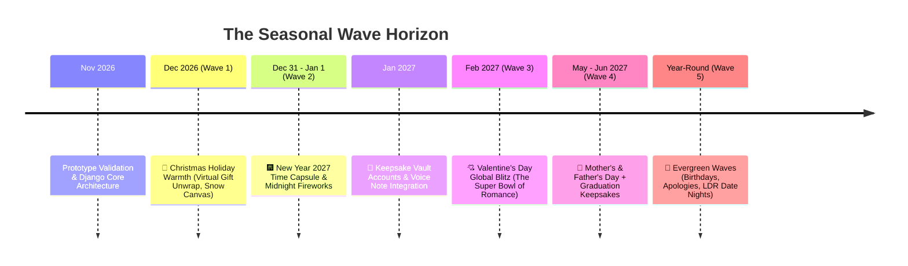

 oReject["Instantly Blocked ❌"]
```

1. **Pre-Submission Sentiment Filter**: Real-time screening against harassment, hate speech, or profanity.
2. **Community Flagging**: Any viewer can discreetly flag a note; 3 flags temporarily hides it until admin review.
3. **No Doxxing / Privacy Protection**: Phone numbers, full addresses, and social handles are automatically redacted from public wall notes.

---

## 8. The Seasonal Growth Waves & Holiday Campaign Playbook

Seasonal moments are the **growth rocket fuel** for emotional platforms. By aligning bespoke visual motifs, soundscapes, and interaction mechanics with the global calendar, the platform catches massive natural viral waves throughout the year:



---

### 🎄 Wave 1: Christmas & Holiday Warmth (December 2026)
*Target: Lovers, Family Members, Long-Distance Loved Ones, Mentors, Friends*

#### 1. Core Emotional Narrative
Christmas is defined by warmth, gratitude, togetherness, and thoughtful gift-giving. Many loved ones are separated by distance or want to give something deeply personal alongside or instead of commercial gifts.

#### 2. Bespoke 10/10 Interactive Mechanics:
- **🎁 3D Gift Box Ribbon-Untying & Unwrap**:
  - The recipient is presented with a luxury holiday gift box wrapped in velvet ribbon.
  - Dragging a finger unties the ribbon with a tactile whoosh; the lid pops open in 3D, releasing gold sparkles and seasonal pine/holly confetti with gentle sleigh bell chimes.
- **❄️ Interactive Falling Snow Canvas**:
  - Realistic snowfall with gentle wind drift; touching the screen melts snowflakes under the finger with soft ice sparkles.
- **🎄 The Clickable Memory Christmas Tree**:
  - A stylized, minimalist holiday pine tree where hanging ornaments glow.
  - Tapping an ornament zooms in to reveal a photo memory from the past year with a personal note.
- **🔥 Fireside Cozy Soundscape**:
  - Crackling fireplace ambience blended with gentle acoustic guitar or lo-fi holiday piano (*"Silent Night" / "Have Yourself a Merry Little Christmas"* variations).

#### 3. Hero Templates for Christmas:
1. *"Christmas Morning for My Love"*: Virtual gift box that reveals photos of the year + an invitation for holiday dinner.
2. *"Mom & Dad Holiday Blessing"*: A warm letter of gratitude thanking parents for everything, designed for easy reading on WhatsApp.
3. *"Faraway Warmth"*: For friends or relatives abroad who cannot be home for the holidays.

#### 4. Viral Distribution Loop:
- Sent on Christmas Eve and Christmas Morning directly via WhatsApp family groups and direct chats.
- Footer prompt: *"Send holiday warmth to someone you cherish — Make your free Christmas surprise in 30s"*.

---

### 🎆 Wave 2: New Year 2027 Midnight Countdown & Time Capsule (Dec 28 - Jan 3)
*Target: Partners, Best Friends, Sibling Groups, Inner Circles*

#### 1. Core Emotional Narrative
The transition into a new year is uniquely reflective. People reminisce on the memories that defined their year and make heartfelt resolutions and promises for the year ahead.

#### 2. Bespoke 10/10 Interactive Mechanics:
- **⏳ Live Midnight Sync Countdown**:
  - The page displays a sleek, glowing clock counting down to **Midnight, January 1, 2027**, automatically synced to the recipient's local timezone.
- **🎆 Midnight Fireworks & Celebration Canvas**:
  - Exactly at 12:00:00 AM (or on button unlock for early senders), the screen erupts in cinematic canvas fireworks with rich, booming audio and gold celebration confetti.
- **📖 "Our 2026 in Review" Memory Flipbook**:
  - A stylish 3D turnable booklet with the top 5 moments shared between the sender and recipient over the past 365 days ("Our Best Trip", "The Hard Day We Got Through", "Our Hardest Laugh").
- **🥂 New Year 2027 Promise Scratch Card**:
  - Recipient rubs a gold scratch layer to reveal the sender's resolution or promise to them for 2027 (e.g. *"In 2027, I promise we'll finally take that trip to the coast"*).

#### 3. Hero Templates for New Year:
1. *"Entering 2027 With You"*: Sent to romantic partners right before midnight.
2. *"The 2026 Hall of Fame"*: Sent between best friends celebrating hilarious milestones and inside jokes.
3. *"New Year Gratitude Capsule"*: Unsent or heartfelt messages to people who made a difference in 2026.

---

### 💘 Wave 3: Valentine's Day Global Blitz (February 2027 — The Super Bowl)
*Target: Couples, Crushes, Daters, Secret Admirers, Long-Distance Lovers*

#### 1. Core Emotional Narrative
The undisputed peak of romantic micro-experiences worldwide. People want to stand out, make their partner feel like the center of the universe, or playfully confess feelings without boring, clunky traditional cards.

#### 2. Bespoke 10/10 Interactive Mechanics:
- **🏃‍♂️ The Runaway "No" Button Date Lock-In (The Elvis & Tina Master Engine)**:
  - Playful question ("Will you be my Valentine?", "Ice cream date this Friday?").
  - The "No" button dodges touch/cursor with hilarious progressive psychological stages ("Wait, are you sure? 🥺", "Ice cream on me though! 🍨", "I am running out of breath! 🏃‍♂️💨") until it surrenders and vanishes, forcing a joyful "YES!".
- **💌 The 3D Crimson & Gold Wax-Sealed Letter**:
  - Authentic wax seal cracked with haptic feedback, unfolding into a personalized typewriter confession with ambient romantic lo-fi piano.
- **🎟️ Secret Admirer Mystery Voucher (The Hildah Model)**:
  - 100% anonymous cute voucher that lets a crush guess who sent it or unlock a mystery date.
- **📸 "10 Reasons Why I Fell for You" Carousel**:
  - Horizontal polaroid cards with smooth momentum swipe, each card revealing a sweet quirk or memory.
- **💬 Luminous 1-Tap WhatsApp Lock-In**:
  - Live pre-filled reply bubble (*"Okay you win 😍 I saw your surprise, YES to Valentine's! ❤️"*) with 1-tap direct WhatsApp deep link.

#### 3. Viral TikTok & Reels Distribution Loop:
- Screen-recording the runaway "No" button and typewriter reveal is **naturally viral content**.
- TikTok / Instagram Reels campaign: *"I made this interactive site for my girl and her reaction was priceless 😭"* ➔ Millions of organic views linking directly to the creator studio.

---

### 🌸 Wave 4: Mother's Day, Father's Day & Graduations (May - June 2027)
*Target: Parents, Guardians, Mentors, Graduating Siblings*

#### 1. Core Emotional Narrative
Deep, tear-jerking gratitude and honor. Children often struggle to put into words how much their parents' sacrifices mean to them.

#### 2. Bespoke 10/10 Interactive Mechanics:
- **👶 Nostalgic Childhood Flashback Deck**:
  - Side-by-side transition: old childhood photo fading into a modern photo of the sender and parent today.
- **🎙️ Direct Voice Note Audio Embed**:
  - Senders can record a 30-second authentic voice message that plays with an audio waveform visualizer over gentle ambient piano.
- **📜 "10 Things I Never Thanked You Enough For" Parchment**:
  - A scrollable luxury parchment document with numbered, heartfelt gratitudes.

---

### 🎂 Wave 5: Evergreen Year-Round Moments (Every Single Day)
*Target: Everyday Life Connections*

The platform thrives between major holidays through daily human milestones:
1. **🎂 Birthdays**: Virtual cake where the recipient taps to "blow out" the animated candles, triggering a confetti burst and birthday photo gallery.
2. **☕ "I'm Sorry / Can I Buy You Coffee?" (Apology & Reconciliation)**:
   - A gentle, disarming micro-experience designed to break the ice after an argument or silence.
3. **✈️ Long Distance Relationship (LDR) Date Nights**:
   - Synchronized audio and interactive letters bridging miles between partners.
4. **✨ "Just Because / Thinking of You"**:
   - Random Tuesday surprise to brighten a stressful workday with zero special occasion needed.

---

## 9. Immediate Execution Steps

1. **Confirm Product Name**: **Blushly** (*blushly.app*) vs **Fondly** (*fondly.app*).
2. **Scaffold Django App**: Initialize Django with the `experiences` and `community` apps.
3. **Implement the 10/10 Core Scene Partials**:
   - `envelope.html` (3D wax seal)
   - `typewriter.html` (paced typewriter)
   - `polaroids.html` (flippable memories)
   - `dodge_btn.html` (psychological runaway No)
   - `gift_unwrap.html` (holiday ribbon & gift box)
   - `whatsapp_cta.html` (luminous 1-tap lock-in)
4. **Build "The Whisper Garden" Public Feed**: A dark, glowing canvas of anonymous love notes with floating lanterns and heartbeat reactions.

---
*Created with passion for connecting human hearts through technology.*
