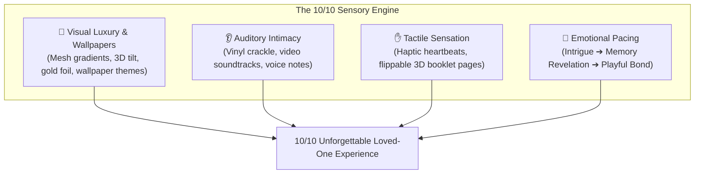
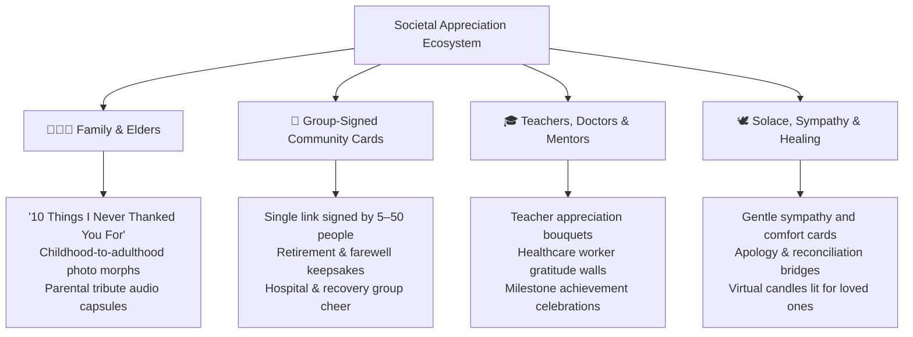
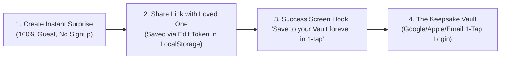
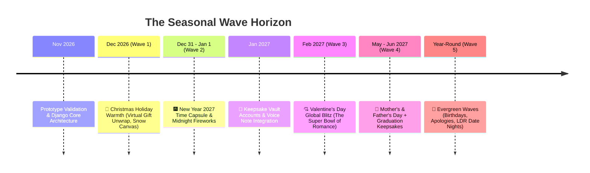

# 💖 Project Blueprint: The Sentimental Micro-Experience & Social Love Platform
*From a Single Love Letter to a Global Movement of Meaningful Human Connection*

---

## 1. The Core Philosophy: "2/10 Prototype vs. 10/10 Masterpiece"

> [!IMPORTANT]
> **The Paradigm Shift**:  
> The early HTML files in this project (`tina.html`, `letter.html`, `index.html`) were quick **proof-of-concept prototypes (rated 1/10 to 2/10)**. They successfully proved the emotional mechanics (typewriter suspense, dodge button psychology, 1-tap WhatsApp response loops), but they are **not the ceiling** of what this platform will be.
>
> The actual production platform must be a **10/10 world-class digital keepsake**—exquisitely styled, deeply sweet, cinematographically paced, and engineered with the visual and emotional polish of an Apple award-winning app or a luxury Studio Ghibli interactive experience.

### Prototype (2/10) vs. Production Masterpiece (10/10)

| Dimension | Early Prototype (1-2 / 10) | Production Platform (10 / 10 Masterpiece) |
| :--- | :--- | :--- |
| **Visual Atmosphere** | Flat `#ffe4ec` pink background, standard box shadows, white cards. | **Dynamic atmospheric depth**: Silky mesh gradients, ambient lighting bloom, subtle floating particle physics, glassmorphic frosted depth (`backdrop-filter: blur()`), organic linen cardstock, and customizable aesthetic wallpapers. |
| **Typography** | Default sans-serif (`Arial`, basic `Outfit`). | **Bespoke editorial pairing**: High-end editorial serifs (*Cormorant Garamond*, *Playfair Display*) paired with clean geometric modern sans (*Plus Jakarta Sans*) and delicate handwritten calligraphy accents. |
| **Tactile & Physics** | Linear CSS button transitions. | **Natural spring physics & 3D tilt**: Gyroscope-enabled 3D parallax on mobile, cards tilt with realistic light refraction on gold foil edges, authentic physical paper fold/curl dynamics. |
| **Audio Immersion** | Single looping MP3 audio track. | **Spatial multi-layered soundscapes**: High-fidelity ambient textures (crackling fireplace, warm vinyl crackle, gentle rain against glass) blended with video/audio soundtracks (*A Whole New World*) and voice note embeds. |
| **Haptics** | Basic single vibration tick. | **Heartbeat & rhythmic tactile feedback**: Multi-stage haptic pulses (heartbeat flutter on opening, mechanical click on keystrokes, soft thud on button drops). |
| **Interactive Formats** | Single-page scroll with a question button. | **Multi-scene storytelling suites**: 3D wax-sealed envelopes, flippable memory polaroid decks, interactive 3D turnable booklets, gold foil scratch-to-reveal cards, gift unwrapping with confetti physics. |
| **Societal Scope** | Isolated 1-to-1 links only. | **Community Love & Appreciation Ecosystem**: Public anonymous confession walls ("The Whisper Garden"), group-signed teacher/mentor appreciation cards, parent gratitude archives, and a personal "Keepsake Vault". |



---

## 2. Brand Identity & Name Candidates

The platform name must feel **warm, modern, memorable, playful, and emotionally resonant**—neither overly cheesy nor corporate:

| Candidate Name | Suggested Domain / Handle | Vibe & Brand Personality | Why It Works |
| :--- | :--- | :--- | :--- |
| **1. Blushly** ⭐ *(Top Pick)* | `blushly.app`<br/>`blushly.love` | Playful, sweet, viral, delightful | "I made you a Blushly" — instantly describes that physical feeling of a warm smile and rosy cheeks when someone says something touching. Highly brandable for Gen Z & Millennials. |
| **2. Fondly** ⭐ *(Universal)* | `fondly.app`<br/>`fondly.link` | Warm, timeless, universally sentimental | Evokes the classic, heartfelt sign-off *"Yours fondly"*. Works seamlessly across lovers, mothers, fathers, siblings, and friends without feeling too exclusively romantic. |
| **3. DearYou** | `dearyou.link`<br/>`dearyou.me` | Intimate, poetic, personal storytelling | Turns every shared web link into a digital letter addressed specifically to the person you cherish. |
| **4. Heartwire** | `heartwire.app`<br/>`heartwire.me` | Modern, kinetic, emotional connection | Connects two hearts across digital wires. Sounds like a tech-first modern emotional communication tool. |
| **5. Whispr** | `whispr.love`<br/>`whispr.to` | Secretive, playful, precious | Evokes a private message shared in confidence, perfect for surprises, confessions, and heartfelt truths. |

---

## 3. The Cozy & Cinematic Atmosphere Engine (Wallpapers & Motion)

A cornerstone of a **10/10 experience** is visual warmth and coziness. Senders and recipients can customize and immerse themselves in bespoke aesthetic environments:

```
┌────────────────────────────────────────────────────────────────────────┐
│                   THE COZY WALLPAPER & THEME ENGINE                    │
├─────────────────────────┬──────────────────────────────────────────────┤
│ 🌌 **Midnight Stargazing**│ Deep cosmic indigo, twinkling star canvas,   │
│                         │ shooting stars, gentle violet ambient glows   │
├─────────────────────────┼──────────────────────────────────────────────┤
│ 🔥 **Fireside Hearth**  │ Warm amber, crackling fireplace audio,       │
│                         │ slow-rising golden embers, cozy cedar tones  │
├─────────────────────────┼──────────────────────────────────────────────┤
│ 🌅 **Golden Hour**      │ Honey-gold sunset gradients, lens flare,     │
│                         │ soft peach horizon, warm acoustic guitar     │
├─────────────────────────┼──────────────────────────────────────────────┤
│ 🌸 **Sakura Dream**     │ Muted rose & cream, drifting cherry blossom  │
│                         │ petals with gentle sinusoidal wind physics   │
├─────────────────────────┼──────────────────────────────────────────────┤
│ ☕ **Rainy Cafe**        │ Muted slate blue, raindrops trickling on     │
│                         │ glass, warm window light, cozy lo-fi beats   │
├─────────────────────────┼──────────────────────────────────────────────┤
│ 🖼️ **Portrait Aura**     │ The recipient's own photo blurred into a     │
│ *(Proven in today.html)*│ 12-second breathing ambient aura background  │
└─────────────────────────┴──────────────────────────────────────────────┘
```

### Motion Design Principles for "Coziness":
1. **Breathing Light**: Cards and portrait frames do not sit static; they pulse with a slow, biological 12-second rhythm (`ambientBreathe`), mimicking deep calm breathing or candlelight.
2. **Sinusoidal Sway Physics**: Falling petals, golden stardust, and confetti do not drop in straight robotic lines—they sway gently with natural wind currents.
3. **Smooth Scroll Cam**: During typewriter reveals, the screen automatically tracks the typing cursor, gently scrolling downward so text is never clipped or hidden beneath mobile viewports.

---

## 4. Rich Media, Galleries & Cinematic Audio Architecture

To elevate experiences into interactive keepsakes that people revisit for years, the platform features a complete multimedia engine:

### 1. Interactive 3D Polaroid & Memory Galleries
- **The Flippable Polaroid Scrapbook**: Photos styled as vintage prints pinned with washi tape. Tapping any photo flips it in 3D space with authentic paper curl physics, revealing the date, location, and sender's handwritten memory note on the back.
- **Cinematic Film Reel with Ken Burns Zoom**: High-resolution photos slowly pan and zoom with subtle vintage film grain, giving casual mobile snapshots the feeling of a cinema film.

### 2. Video Soundtrack & Soundscape Engine
- **Video Soundtrack Integration**: Senders can pair their surprise with iconic video soundtracks (e.g. *A Whole New World*, wedding songs, indie acoustic covers) running as smooth background audio.
- **Floating "Now Playing" Equalizer Pill**: A sleek glassmorphic pill at the top of the screen displays the song title alongside animated equalizer waves, allowing 1-tap mute/unmute at any moment.
- **Authentic Voice Note Embeds**: Senders can record or upload a 30-to-60 second voice note. When played, the audio visualizes as a glowing waveform while ambient piano music dips gently in the background.

---

## 5. Societal & Community Appreciation Ecosystem (Beyond Romance)

While romantic dating and love letters are the viral engine, **deep societal appreciation** creates profound emotional value and widespread adoption across families, workplaces, and communities:



### 1. Group-Signed Appreciation Keepsakes
- **The Concept**: A team, classroom, or family can collaborate on a single surprise link.
- **How It Works**:
  - The organizer creates an appreciation card for a teacher, boss, nurse, or retiring colleague.
  - An invite link is shared in WhatsApp or Slack: *"Add your note for Mr. Davis's retirement"*.
  - Contributors add their photo and note without creating an account.
  - The recipient opens a luxury digital scrapbook filled with heartfelt notes from dozens of people.

### 2. Parental & Elder Honor
- High-legibility typography, nostalgic audio, and side-by-side childhood memories designed to make parents shed tears of joy.
- Ideal for Mother's Day, Father's Day, and 50th/60th birthdays.

### 3. The Public "Whisper Garden" (Community Love Wall)
- An anonymous cosmic canvas of unspoken confessions, gratitude, and holiday blessings.
- Community members interact by **releasing floating sky lanterns**, **sending heartbeats**, or **folding virtual paper airplanes** containing kind words.

---

## 6. Progressive Account System ("The Keepsake Vault")

We do not force users to sign up upfront. We use **Progressive Profiling**:



### Inside "The Keepsake Vault" (User Dashboard):
1. **Sent Keepsakes**: 
   - Live delivery status & view counts (e.g., *"Tina opened your surprise 4 times"*).
   - One-click duplicate or edit.
   - Archive of sent love letters.
2. **Received Keepsakes (The Digital Shoebox)**:
   - When a recipient creates an account, all surprises sent to their phone or email are filed into their personal **Keepsake Box**—a digital heirloom they can revisit years down the road.
3. **Scheduled Drops (Holiday Automation)**:
   - Schedule surprises to automatically unlock on **Christmas Morning at 8:00 AM**, **New Year's Eve at Midnight**, or **Valentine's Day**.
4. **Drafts & In-Progress Books**:
   - Save multi-page photo booklets in progress and finish them later.

---

## 7. Django Architecture & Social Data Models

Django's ORM, authentication system, and admin panel make managing both **private surprises**, **media attachments**, and the **public community wall** effortless:

```python
import uuid
from django.db import models
from django.contrib.auth.models import AbstractUser


class User(AbstractUser):
    """Extended user for personal Keepsake Vault"""
    phone_number = models.CharField(max_length=20, blank=True)
    avatar = models.ImageField(upload_to='avatars/', blank=True)
    is_premium = models.BooleanField(default=False)


class Experience(models.Model):
    """Private 1-to-1 and Group Sentimental Experiences"""
    THEME_CHOICES = [
        ('romantic', 'Romantic & Dating (Tina & Elvis Style)'),
        ('christmas', 'Holiday Warmth & Christmas Unwrapping'),
        ('new_year', 'New Year 2027 Celebration'),
        ('gratitude', 'Family & Friends Gratitude'),
        ('group_card', 'Group-Signed Appreciation Card'),
        ('secret', 'Anonymous Secret Admirer'),
    ]

    WALLPAPER_CHOICES = [
        ('portrait_blur', 'Ambient Portrait Glow (Dynamic)'),
        ('midnight_stars', 'Midnight Stargazing (Deep Cosmos)'),
        ('cozy_fireside', 'Cozy Fireside Hearth (Warm Embers)'),
        ('golden_hour', 'Golden Hour Sunset (Honey-Gold)'),
        ('sakura_dream', 'Sakura Dream (Floating Petals)'),
        ('rainy_cafe', 'Rainy Cafe Window (Muted Slate)'),
    ]

    id = models.UUIDField(primary_key=True, default=uuid.uuid4, editable=False)
    slug = models.SlugField(max_length=60, unique=True, db_index=True)
    
    # Ownership (Optional User for Zero-Signup guest creations)
    creator = models.ForeignKey(User, related_name='created_experiences', null=True, blank=True, on_delete=models.SET_NULL)
    secret_edit_token = models.CharField(max_length=64, default=uuid.uuid4)  # For guest creators
    
    # Parties
    recipient_name = models.CharField(max_length=50)
    sender_name = models.CharField(max_length=50)
    sender_whatsapp = models.CharField(max_length=20, blank=True)
    
    # Aesthetics & Media
    theme = models.CharField(max_length=30, choices=THEME_CHOICES, default='romantic')
    wallpaper = models.CharField(max_length=30, choices=WALLPAPER_CHOICES, default='portrait_blur')
    custom_wallpaper = models.ImageField(upload_to='wallpapers/', blank=True, null=True)
    audio_track = models.CharField(max_length=150, default='song.mp4')
    voice_note = models.FileField(upload_to='voice_notes/', blank=True, null=True)
    
    # Modular Scene Configs (stored as JSON)
    scenes_data = models.JSONField(default=dict, blank=True)
    
    # Privacy & Status
    is_public_on_wall = models.BooleanField(default=False)
    scheduled_for = models.DateTimeField(null=True, blank=True)
    views_count = models.PositiveIntegerField(default=0)
    created_at = models.DateTimeField(auto_now_add=True)


class MemoryPhoto(models.Model):
    """Photos for the 3D Polaroid flipbook gallery"""
    experience = models.ForeignKey(Experience, related_name='photos', on_delete=models.CASCADE)
    image = models.ImageField(upload_to='memories/%Y/%m/')
    caption = models.CharField(max_length=150, blank=True)
    date_taken = models.CharField(max_length=50, blank=True)
    order = models.PositiveSmallIntegerField(default=0)


class GroupContributorNote(models.Model):
    """Individual signatures on a group appreciation card"""
    experience = models.ForeignKey(Experience, related_name='group_notes', on_delete=models.CASCADE)
    contributor_name = models.CharField(max_length=60)
    message = models.TextField(max_length=400)
    photo = models.ImageField(upload_to='group_notes/', blank=True, null=True)
    created_at = models.DateTimeField(auto_now_add=True)


class LoveWallPost(models.Model):
    """The Whisper Garden Community Confession & Gratitude Wall"""
    id = models.UUIDField(primary_key=True, default=uuid.uuid4, editable=False)
    author = models.ForeignKey(User, null=True, blank=True, on_delete=models.SET_NULL)
    recipient_name = models.CharField(max_length=50)
    message = models.TextField(max_length=500)
    tag = models.CharField(max_length=30, default='confession')
    color_scheme = models.CharField(max_length=30, default='sunset')
    
    heartbeats_count = models.PositiveIntegerField(default=0)
    lanterns_count = models.PositiveIntegerField(default=0)
    airplanes_count = models.PositiveIntegerField(default=0)
    
    is_approved = models.BooleanField(default=True)
    created_at = models.DateTimeField(auto_now_add=True)
```

---

## 8. The Seasonal Growth Waves & Holiday Campaign Playbook



### 🎄 Wave 1: Christmas & Holiday Warmth (December 2026)
- **3D Gift Box Ribbon-Untying & Unwrap**: Velvet ribbon pulled with haptic whoosh; lid pops off with pine confetti and gold sparkles.
- **Falling Snow Canvas**: Realistic snowfall with wind drift that melts under touch.
- **Clickable Memory Tree**: Minimalist pine tree with glowing ornaments revealing 2026 memories.
- **Fireside Soundscapes**: Warm crackling fireplace with acoustic carols.

### 🎆 Wave 2: New Year 2027 Midnight Countdown & Time Capsule (Dec 28 - Jan 3)
- **Live Midnight Sync Clock**: Countdown to 12:00:00 AM synchronized to the recipient's local timezone.
- **Midnight Fireworks Spectacle**: Full-screen canvas fireworks with rich audio booms and gold confetti.
- **"Our 2026 in Review" Memory Flipbook**: 3D turnable booklet with the top 5 moments of the year.
- **2027 Promise Scratch Card**: Gold foil scratch layer revealing resolutions and promises.

### 💘 Wave 3: Valentine's Day Global Blitz (February 2027 — The Super Bowl)
- **The Runaway "No" Button Date Lock-In (The Elvis & Tina Master Engine)**: Playful dodge mechanics forcing a joyful "YES!".
- **3D Crimson & Gold Wax-Sealed Letter**: Wax seal cracked with haptic feedback, unfolding into a personalized typewriter confession.
- **Secret Admirer Mystery Voucher (The Hildah Model)**: 100% anonymous cute vouchers for crushes.
- **TikTok & Reels Viral Wave**: Organic screen recordings of couples' reactions reaching millions.

### 🌸 Wave 4: Mother's Day, Father's Day & Graduations (May - June 2027)
- **Childhood Flashback Deck**: Nostalgic side-by-side photo transitions.
- **Authentic Voice Note Player**: High-fidelity audio tributes from children and siblings.
- **"10 Things I Never Thanked You For"**: Luxury parchment scroll with numbered gratitudes.

### 🎂 Wave 5: Evergreen Daily Moments (Birthdays, Apologies, Random Love)
- **Virtual Birthday Cake with Blow-Out Candles**: Recipient taps or blows to extinguish candles and trigger confetti.
- **"I'm Sorry / Can I Buy You Coffee?"**: Disarming, sweet reconciliation bridges.
- **LDR Date Nights**: Synchronized letters and soundtracks across time zones.

---

## 9. Immediate Execution Steps

1. **Confirm Product Name**: **Blushly** (*blushly.app*) vs **Fondly** (*fondly.app*).
2. **Scaffold Django App**: Initialize Django with the `experiences` and `community` apps.
3. **Implement the 10/10 Core Scene Partials**:
   - `envelope.html` (3D wax seal)
   - `typewriter.html` (paced typewriter with auto-scroll)
   - `polaroids.html` (flippable memories)
   - `dodge_btn.html` (psychological runaway No)
   - `gift_unwrap.html` (holiday ribbon & gift box)
   - `whatsapp_cta.html` (luminous 1-tap lock-in)
4. **Build "The Whisper Garden" Public Feed**: A dark, glowing canvas of anonymous love notes with floating lanterns and heartbeat reactions.

---
*Created with passion for connecting human hearts through technology.*
